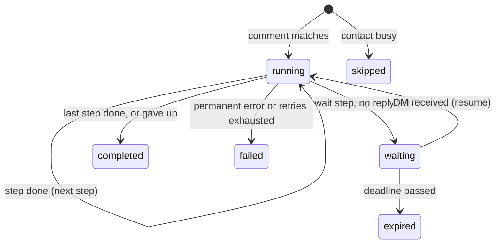

# Architecture decisions

This document records the design decisions behind the comment automation backend, the alternatives considered, and what each decision costs. The README covers how to run the project.

Implementation status: decisions 1–17 are implemented. Decision 18 (rate limiting) is intentionally deferred for this take-home; the proposed production approach is documented below. The open items at the end distinguish known behavioral tradeoffs from remaining implementation work.

---

## 1. No workflow engine: a Postgres-backed state machine

**Decision.** A run is a row in `runs` with a `status` and a `current_step` pointer. Workers advance it one step at a time. There is no Temporal, Step Functions, or similar.

**Why.** The automation model has three step types and is strictly linear. A state machine in the database we already run means fewer moving parts to deploy, monitor, and reason about, and every run's state is one `SELECT` away.

**When we would move to Temporal.** Branching flows, long multi-step flows with many waits, or many teams writing their own step types. At that point the hand-written retry, timer, and resume logic stops being cheaper than adopting an engine that provides it.

## 2. Postgres as the job queue

**Decision.** No Redis or message broker. The work queues are tables: unprocessed rows in `inbound_events` for the dispatcher, and `runs` with `status = 'running'` and `wake_at <= now` for workers. Both are polled.

**Why.** Enqueueing work and changing state happen in the same transaction, so there is no dual-write problem between a database and a broker. Throughput needs are modest.

**Cost.** Polling adds latency (bounded by the poll interval) and load. `LISTEN/NOTIFY` could cut latency later without changing the model.

## 3. Automation model: a trigger plus an ordered list of typed steps

**Decision.**
- Trigger: `comment_keyword { keyword, post_ids | null }`, case-insensitive, whole-word match.
- Steps: `reply_to_comment { text }`, `send_dm { text }`, `wait_for_reply { validator, save_as, timeout_seconds, max_reprompts, reprompt_text, give_up_text }`.
- Text fields support `{{var}}` templating from the run context.
- A linear list, not a DAG.

**Why.** It covers the use case with the smallest model that can be validated completely when an automation is published. Branching is out of scope (see the README).

**Extensibility.** Step types live in two typed tables: definitions (validation and variables) in `core/steps.ts` and executors in `app/executors.ts`. Both are typed over the step union, so adding a step type without an executor fails to compile.

## 4. Immutable versions, pinned by runs

**Decision.** Editing an automation inserts a new row in `automation_versions` and moves `automations.current_version_id`. A database trigger rejects any `UPDATE` on `automation_versions`. Each run stores the version it started on.

**Why.** An edit must never change a conversation that is already in flight: a step index in a run means the same step for the whole life of the run. Immutability also lets workers cache versions indefinitely.

**Related.** Disabling an automation stops new triggers only. In-flight runs finish on their pinned version.

## 5. Code structure: functional core, imperative shell

**Decision.**

| Layer | Contents | Rule |
|---|---|---|
| `src/core/` | Types, validation, trigger matching, run transitions, the conversation state machine, the run planner, retry policy | Pure: no I/O, no imports outside `core/` |
| `src/store/` | One module of plain query functions per table, mapping rows to domain types | No business decisions. Every function takes a `Queryable` (pool or transaction), so the caller owns the transaction |
| `src/app/` | Use cases: event dispatcher, worker, scheduler, step executors, ingestion | Orchestration only: load, ask `core/`, persist, call the platform. No SQL |
| `src/platform/` | Platform client port, Instagram rules, mock client | |

**Alternatives considered.**
- *Full DDD (aggregates and repositories).* The hard parts of this system are concurrency semantics that fight the aggregate pattern: a step has to commit a `pending` row before the platform call, and claiming a run is a single `UPDATE ... SKIP LOCKED` query, not a load followed by a lock.
- *Plain transaction scripts.* Simple, but the business rules (re-prompts, give-up, who runs and who is skipped) end up buried in SQL-heavy code and can only be tested against a database.

**Why the hybrid.** The business rules are pure and unit-tested without Postgres. The concurrency SQL stays visible in `store/`, under names that state its guarantee (`claimRunnable`, `applyIfLeaseHeld`, `resumeIfWaiting`).

## 6. Ingestion: store every event, deduplicate on the platform's id

**Decision.** The webhook handler only inserts into `inbound_events` and returns. Duplicate deliveries are dropped by `UNIQUE (platform, platform_event_id)` with `ON CONFLICT DO NOTHING`. Every comment and DM is stored, whether or not anything is waiting for it.

**Why.** Keeping business logic off the request path keeps webhook responses fast and makes retries from the platform harmless. Storing DMs nobody is waiting for is what makes it possible to handle a reply that arrives before its run is waiting (decision 14). The id is scoped by platform because ids are only unique within one platform.

## 7. Event dispatch: one contact at a time, oldest event first

**Decision.** The dispatcher finds contacts with unprocessed events and takes `pg_try_advisory_xact_lock` on each contact. If another dispatcher holds that contact, it moves on. The holder processes all of that contact's unprocessed events in `id` order, in one transaction.

**Why not row locks with `SKIP LOCKED` here.** Two dispatchers would each lock one of a contact's events and then each wait for the contact lock the other holds: a deadlock. With the contact lock as the only mutual exclusion there is no lock ordering to get wrong, and a contact's events are never handled out of order or by two dispatchers at once.

**Caveat.** `id` reflects insert order, not commit order, so two webhooks for the same contact that arrive within milliseconds could be handled in the other order. Platforms do not guarantee webhook ordering anyway.

## 8. At most one active run per contact

**Decision.** A partial unique index allows at most one run with status `running` or `waiting` per `(account_id, platform, contact_id)`. A trigger that fires while the contact has an active run creates a run with status `skipped` and `context.outcome = 'contact_busy'`. When one comment matches several automations, the oldest automation runs and the rest are skipped.

**Why.** The spec's index covered only `waiting`. That lets a contact who comments twice quickly get two runs that both send the DM before either reaches the wait. Covering `running` as well closes that gap.

**Cost.** A contact in a conversation with one automation cannot trigger another automation, even one that only replies to the comment. This is deliberate: two bots messaging one person at once is worse.

**Enforcement.** The rule spans many run rows, so the database enforces it (unique index) and the dispatcher checks it under the contact lock. The pure decision lives in `core/planner.ts`. A dedicated per-contact "conversation" aggregate was considered and rejected: it would add a table and a second write per run to enforce something the index already guarantees.

## 9. Run deduplication key

**Decision.** `UNIQUE (automation_id, trigger_event_id)` on `runs`, rather than the version id.

**Why.** If the same comment were processed again after an edit, a key on the version id would allow a second run on the new version. The dispatcher already marks an event processed in the same transaction that creates its runs, so this is defense in depth.

## 10. Workers claim runs with leases

**Decision.** A worker claims a run in one autocommitted statement: `UPDATE runs SET lease_until = now + 30s WHERE id = (SELECT ... FOR UPDATE SKIP LOCKED)`. It executes the current step outside any transaction, then writes the result. Every write after the claim is conditioned on `lease_until` still holding the value this worker set, so that value works as a fencing token. A worker that crashes simply lets its lease expire, and another worker picks the run up.

**Alternative rejected.** Holding a row lock in an open transaction across the platform call. It is simpler, but every in-flight send holds a pooled connection and an open transaction, so the pool size caps send concurrency.

**One step per claim.** After each step the run is released and re-queued with `wake_at = now`. Long automations cannot hog a worker, and every step boundary is a durable checkpoint. The cost is one extra claim query per step.

## 11. Side effects are at-least-once

**Decision.** Every outbound message gets a `step_executions` row, keyed by `(run_id, step_index, effect_key)`:
1. The row is written as `pending` (fenced by the lease) before the platform call.
2. It is marked `sent` with the platform's message id after the call.
3. A retry of a step whose effect is already `sent` skips the call.

`effect_key` separates multiple sends from one step: `main`, `reprompt:1`, `reprompt:2`, `give_up`. Marking an effect `sent` is keyed by `attempt`, so a stale worker cannot overwrite a newer attempt's result.

**Why not exactly-once.** If a worker crashes after the platform accepted the message but before `sent` is committed, the row stays `pending` and the retry sends it again. Closing that window requires the platform to deduplicate on an idempotency key we supply, and the messaging APIs we target do not offer one. Lease fencing cannot help either: a stale worker may already be inside the platform call when its lease expires. The trade is a rare duplicate message rather than a lost one. A test demonstrates exactly this case.

## 12. Retries and failure classification

**Decision.**
- `TransientPlatformError`: retried with exponential backoff and full jitter. Base 1 s, cap 5 min, at most 5 attempts.
- `PermanentPlatformError` and a refusal from the platform rules: the run fails immediately with the reason in `runs.error`.
- Any other error (a bug): treated as permanent.

**Why unexpected errors are permanent.** Retrying a bug only hides it. If the database itself is down, the write that records the failure fails too, and the expired lease makes the run claimable again, so infrastructure outages still recover.

**Note.** The backoff and attempt numbers are placeholders, not tuned values.

## 13. Platform rules live in the adapter

**Decision.** Each platform adapter exposes `canSendDm(facts)`, a pure function. The executor gathers the facts (comment time, whether the private reply was used, the contact's last inbound DM) and the adapter decides. The Instagram rules modeled:
- A standard DM is allowed within 24 hours of the contact's last message.
- Otherwise the only way in is one private reply per comment, within 7 days of the comment.

**Why.** Platform policy changes independently of the engine, and a pure function is trivial to test. The permission check runs inside the `send` bookkeeping, so a DM that was already sent is never blocked on replay, and a refusal is recorded in `step_executions`.

`private_reply_used` is tracked in the run context. That is equivalent to tracking it per comment, because one comment produces at most one non-skipped run.

## 14. The wait step

**Entering the wait.** The worker takes the contact's advisory lock and looks for the oldest DM from the contact that is not yet consumed and was received at or after `wait.since`. If one exists, it consumes it and evaluates it on the next tick. Otherwise it sets `status = 'waiting'` and `wake_at = now + timeout_seconds`. Lock, check, lease-fenced update, and consume happen in one transaction.

**A DM arrives.** Under the same contact lock, the dispatcher resumes the contact's waiting run if the DM was received after `wait.since` and before the deadline, then marks the DM consumed by that run.

**Why this is race-free.**
- *Entering the wait vs. a DM arriving.* Both hold the contact lock, so the DM is either found by the early-reply check or arrives after the run is `waiting` and resumes it.
- *Resume vs. expiry.* Both are conditional updates on `status = 'waiting'`. Postgres row locking lets exactly one win, and the DM is consumed only if the resume won.
- *Lease lost while entering the wait.* The transaction rolls back, including the consumption of the DM.

**The anchor (`wait.since`).** The time the prompt DM was first queued (its `pending` row), not when it was marked `sent`. The `sent` time is recorded after the platform call returns, and a fast reply can arrive before that. The anchor is set once when the run first enters the wait. Re-prompts do not move it, so a burst like "one sec" followed by "a@b.com" is handled in order rather than the valid address being dropped.

**Evaluating a reply** (pure, in `core/conversation.ts`):
- Valid: the extracted value is saved to `vars[save_as]` and the run advances.
- Invalid, with re-prompts left: send `reprompt_text`, then wait again. Each re-prompt resets the deadline.
- Invalid, no re-prompts left: send `give_up_text` and end the run as `completed` with `context.outcome = 'gave_up'`. It is not `failed`, because nothing broke, and `failed` should be safe to alert on.

**Expiry.** A scheduler loop sets `status = 'expired'` on waiting runs past `wake_at`. Nothing is sent. The dispatcher also refuses DMs received after the deadline, so a lagging scheduler cannot let a late reply through.

**Validation support.** A `wait_for_reply` must directly follow a `send_dm` (enforced when the version is published), so there is always a prompt to anchor to.

## 15. Validation when a version is published

**Decision.** `validateVersion` checks the whole definition before it is saved and reports every issue at once:
- the trigger shape
- each step's config
- `wait_for_reply` directly after a `send_dm`
- every `{{var}}` is defined before it is used: by the trigger (`username`, `comment_text`) or by an earlier step's `save_as`
- `save_as` does not shadow an existing variable

**Why.** A typo in a template fails at publish time, not in the middle of a live conversation.

**Placeholder limits.** `timeout_seconds` must be between 1 and 7 days. `max_reprompts` must be between 0 and 10.

## 16. Matching and validation details

- **Keyword matching** uses Unicode-aware boundaries, because JavaScript's `\b` only understands ASCII. Underscores count as a boundary, so `pricing_info` matches.
- **The email validator** extracts the first address from free text, so "sure, it's ana@x.com" is valid.

## 17. Time is injected

**Decision.** All logic reads time from a `Clock`. Rows written by the engine use the app clock, not the database `now()`.

**Why.** Timeout, backoff, and lease-expiry tests are deterministic: a test advances a fake clock instead of sleeping.

## 18. Rate limiting (deferred)

**Decision.** A per-account token bucket stored in Postgres (`rate_limit_buckets`), updated atomically with `UPDATE ... RETURNING`, and shared by all workers. When no token is available, the run is rescheduled with `wake_at` at the time the next token is due. This does not count as a failed attempt.

**Why deferred.** Rate limiting matters in production, particularly when calling external APIs, but implementing a distributed token bucket would add complexity beyond the core take-home requirements. I prioritized durable workflow execution, concurrency safety, idempotency, and recovery from failures. The proposed mechanism fits the existing Postgres-backed execution model and can be introduced later without redesigning it.

**Why in Postgres.** A token bucket in each worker's memory is not per-account once there is more than one worker.

**Placeholder limit.** Instagram: a burst of 20, then 1 per second.

---

## Testing strategy

- **Core:** pure unit tests, no database.
- **Engine behavior:** tests against real Postgres, one schema per test file so files run in parallel. Concurrency guarantees only exist in the real database, so they are not faked.
- **Determinism:** tests drive the dispatcher, worker, and scheduler with explicit `tick()` calls and a fake clock. Concurrency tests still run several ticks in parallel.
- **Failure-mode tests:** beyond the scenarios derived from the design, there are tests for what happens when something is late, interrupted, or doubled: a worker dying mid-send, a lagging scheduler, a re-prompt that fails transiently.

## Open items

1. **Dispatcher lag at the deadline.** A DM received just before the deadline, but dispatched after the scheduler expired the run, is ignored. A test pins down this behavior. Possible fix: the scheduler skips contacts that still have undispatched DMs.
2. **Unnecessary re-prompt on a burst.** "one sec" followed immediately by "a@b.com" produces a re-prompt before the email is accepted. Correct, but slightly awkward.
3. **Anchor on retried prompts.** The anchor is when the prompt's first attempt was queued. If that attempt fails and a retry succeeds, a DM that arrived in between can count as the answer. A valid email is accepted, and anything else gets a re-prompt, so the effect is benign.
4. **Several valid replies.** If two valid emails arrive together, the second stays unconsumed and is ignored. This is intended.
5. **Intentionally deferred:** the rate limiter (decision 18).
6. **Not yet built:** the webhook HTTP endpoint with payload normalization (including dropping echoes of our own messages and self-authored comments), and the process entrypoint. The implemented work should therefore be understood as the backend workflow engine, not a fully deployable webhook service.
