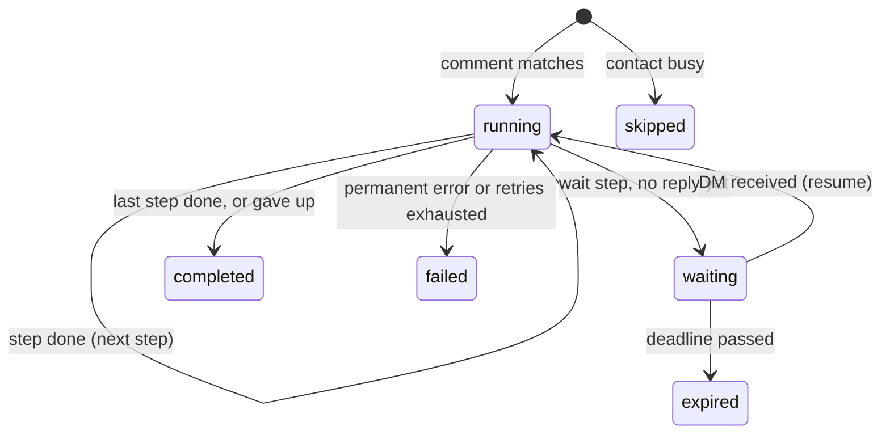

# Architecture decisions

This document records the design decisions behind the comment automation backend, the alternatives considered, and what each decision costs. The README covers how to run the project.

Implementation status: decisions 1–17 and 19 are implemented. Decision 18 (rate limiting) is intentionally deferred for this take-home; the proposed production approach is documented below. The open items at the end distinguish known behavioral tradeoffs from remaining implementation work.

---

## 1. No workflow engine: a Postgres-backed state machine

**Decision.** A run is a row in `runs` with a `status` and a `current_step` pointer. Workers advance it one step at a time. There is no Temporal, Step Functions, or similar.

**Why.** The automation model has three step types and is strictly linear. A state machine in the database we already run means fewer moving parts to deploy, monitor, and reason about, and every run's state is one `SELECT` away.

**When we would move to Temporal.** Branching flows, long multi-step flows with many waits, or many teams writing their own step types. At that point the hand-written retry, timer, and resume logic stops being cheaper than adopting an engine that provides it.

## 2. Postgres as the job queue

**Decision.** No Redis or message broker. The work queues are tables: unprocessed rows in `inbound_events` for the dispatcher, and `runs` with `status = 'running'` and `wake_at <= now` for workers. Both are polled.

**Why.** Enqueueing work and changing state happen in the same transaction, so there is no dual-write problem between a database and a broker. Throughput needs are modest.

**Cost.** Polling adds latency (bounded by the poll interval) and load. `LISTEN/NOTIFY` could cut latency later without changing the model.

## 3. Automation model: a trigger plus an ordered list of typed steps

**Decision.**
- Trigger: `comment_keyword { keyword, post_ids | null }`, case-insensitive, whole-word match.
- Steps: `reply_to_comment { text }`, `send_dm { text }`, `wait_for_reply { validator, save_as, timeout_seconds, max_reprompts, reprompt_text, give_up_text }`.
- Text fields support `{{var}}` templating from the run context.
- A linear list, not a DAG.

**Why.** It covers the use case with the smallest model that can be validated completely when an automation is published. Branching is out of scope (see the README).

**Extensibility.** Step types live in two typed tables: definitions (validation and variables) in `core/steps.ts` and executors in `app/executors.ts`. Both are typed over the step union, so adding a step type without an executor fails to compile.

## 4. Immutable versions, pinned by runs

**Decision.** Editing an automation inserts a new row in `automation_versions` and moves `automations.current_version_id`. A database trigger rejects any `UPDATE` on `automation_versions`. Each run stores the version it started on.

**Why.** An edit must never change a conversation that is already in flight: a step index in a run means the same step for the whole life of the run. Immutability also lets workers cache versions indefinitely.

**Related.** Disabling an automation stops new triggers only. In-flight runs finish on their pinned version.

## 5. Code structure: functional core, imperative shell

**Decision.**

| Layer | Contents | Rule |
|---|---|---|
| `src/core/` | Types, validation, trigger matching, run transitions, the conversation state machine, the run planner, retry policy | Pure: no I/O, no imports outside `core/` |
| `src/store/` | One module of plain query functions per table, mapping rows to domain types | No business decisions. Every function takes a `Queryable` (pool or transaction), so the caller owns the transaction |
| `src/app/` | Use cases: event dispatcher, worker, scheduler, step executors, ingestion | Orchestration only: load, ask `core/`, persist, call the platform. No SQL |
| `src/platform/` | Platform client port, Instagram rules, mock client | |

**Alternatives considered.**
- *Full DDD (aggregates and repositories).* The hard parts of this system are concurrency semantics that fight the aggregate pattern: a step has to commit a `pending` row before the platform call, and claiming a run is a single `UPDATE ... SKIP LOCKED` query, not a load followed by a lock.
- *Plain transaction scripts.* Simple, but the business rules (re-prompts, give-up, who runs and who is skipped) end up buried in SQL-heavy code and can only be tested against a database.

**Why the hybrid.** The business rules are pure and unit-tested without Postgres. The concurrency SQL stays visible in `store/`, under names that state its guarantee (`claimRunnable`, `applyIfLeaseHeld`, `resumeIfWaiting`).

## 6. Ingestion: store every event, deduplicate on the platform's id

**Decision.** The webhook handler only inserts into `inbound_events` and returns. Duplicate deliveries are dropped by `UNIQUE (platform, platform_event_id)` with `ON CONFLICT DO NOTHING`. Every comment and DM is stored, whether or not anything is waiting for it.

**Why.** Keeping business logic off the request path keeps webhook responses fast and makes retries from the platform harmless. Storing DMs nobody is waiting for is what makes it possible to handle a reply that arrives before its run is waiting (decision 14). The id is scoped by platform because ids are only unique within one platform.

## 7. Event dispatch: one contact at a time, oldest event first

**Decision.** The dispatcher finds contacts with unprocessed events and takes `pg_try_advisory_xact_lock` on each contact. If another dispatcher holds that contact, it moves on. Advisory locks are database-wide, so the lock key includes the current schema: two schemas in one database (the parallel test files, or tenants split by schema) never contend for the same contact. The holder processes all of that contact's unprocessed events in `id` order, in one transaction.

**Why not row locks with `SKIP LOCKED` here.** Two dispatchers would each lock one of a contact's events and then each wait for the contact lock the other holds: a deadlock. With the contact lock as the only mutual exclusion there is no lock ordering to get wrong, and a contact's events are never handled out of order or by two dispatchers at once.

**Failure isolation.** Each event is handled inside a savepoint. If it fails, only that event's work is rolled back, the error is reported, and its `dispatch_failures` count goes up. The contact's later events wait behind it, so they are never handled out of order, and the dispatcher moves on to the next contact. Transient database errors (a deadlock, a dropped connection) say nothing about the event, so they are retried on the next tick without counting. After 5 other failures the event is dead-lettered: marked processed, with `dead_lettered_at` and the last error kept, and never used as a reply. Without this, an event that always fails would block its contact forever, keep its waiting run from expiring, and, once there were as many of them as the batch size, stop dispatch for everyone.

**The account's own comments** never trigger an automation, so a public reply that repeats the keyword cannot start a run against the account itself. This assumes `account_id` is the connected account's platform user id. The webhook layer is expected to drop these too (open item 7); the dispatcher check is defense in depth.

**Caveat.** `id` reflects insert order, not commit order, so two webhooks for the same contact that arrive within milliseconds could be handled in the other order. Platforms do not guarantee webhook ordering anyway.

## 8. At most one active run per contact

**Decision.** A partial unique index allows at most one run with status `running` or `waiting` per `(account_id, platform, contact_id)`. A trigger that fires while the contact has an active run creates a run with status `skipped` and `context.outcome = 'contact_busy'`. When one comment matches several automations, the oldest automation runs and the rest are skipped with `context.outcome = 'another_automation_matched'`.

**Why.** The spec's index covered only `waiting`. That lets a contact who comments twice quickly get two runs that both send the DM before either reaches the wait. Covering `running` as well closes that gap.

**Cost.** A contact in a conversation with one automation cannot trigger another automation, even one that only replies to the comment. Nothing is sent for the skipped trigger, not even the public comment reply, and a contact who never answers a prompt stays busy until the wait times out (up to 7 days). This is deliberate: two bots messaging one person at once is worse. The `skipped` rows keep the lost triggers visible.

**Enforcement.** The rule spans many run rows, so the database enforces it (unique index) and the dispatcher checks it under the contact lock. The pure decision lives in `core/planner.ts`. A dedicated per-contact "conversation" aggregate was considered and rejected: it would add a table and a second write per run to enforce something the index already guarantees.

## 9. Run deduplication key

**Decision.** `UNIQUE (automation_id, trigger_event_id)` on `runs`, rather than the version id.

**Why.** If the same comment were processed again after an edit, a key on the version id would allow a second run on the new version. The dispatcher already marks an event processed in the same transaction that creates its runs, so this is defense in depth.

## 10. Workers claim runs with leases

**Decision.** A worker claims a run in one autocommitted statement: `UPDATE runs SET lease_until = now + 30s WHERE id = (SELECT ... FOR UPDATE SKIP LOCKED)`. It executes the current step outside any transaction, then writes the result. Every write after the claim is conditioned on `lease_until` still holding the value this worker set, so that value works as a fencing token. A worker that crashes simply lets its lease expire, and another worker picks the run up.

**Alternative rejected.** Holding a row lock in an open transaction across the platform call. It is simpler, but every in-flight send holds a pooled connection and an open transaction, so the pool size caps send concurrency.

**One step per claim.** After each step the run is released and re-queued with `wake_at = now`. Long automations cannot hog a worker, and every step boundary is a durable checkpoint. The cost is one extra claim query per step.

**Platform calls time out well inside the lease** (10 s against 30 s). A call that hangs is abandoned as a transient failure and retried by the same worker after backoff, instead of outliving the lease while a second worker sends the same message in parallel. The engine aborts the call's `AbortSignal`, so a real client can cancel the request. The worker refuses to start if the timeout is not shorter than the lease.

## 11. Side effects are at-least-once

**Decision.** Every outbound message gets a `step_executions` row, keyed by `(run_id, step_index, effect_key)`:
1. The row is written as `pending` (fenced by the lease) before the platform call.
2. It is marked `sent` with the platform's message id after the call.
3. A retry of a step whose effect is already `sent` skips the call.

`effect_key` separates multiple sends from one step: `main`, `reprompt:1`, `reprompt:2`, `give_up`. Marking an effect `sent` is keyed by `attempt`, so a stale worker cannot overwrite a newer attempt's result.

The attempt counter also bounds crash loops. A worker that dies after every platform call never records a failure, so the retry policy never sees it. Each new attempt still increments `attempt` when it is marked `pending`, and an attempt past the limit fails the run instead of sending again.

Each row also records the `channel` it was sent on (`comment_reply`, `dm`, `private_reply`). When a step is replayed after its effect was already sent, the executor uses the recorded channel rather than recomputing it from current facts, which may have changed since (decision 13).

**Why not exactly-once.** If a worker crashes after the platform accepted the message but before `sent` is committed, the row stays `pending` and the retry sends it again. Closing that window requires the platform to deduplicate on an idempotency key we supply, and the messaging APIs we target do not offer one. Lease fencing cannot help either: a stale worker may already be inside the platform call when its lease expires. The trade is a rare duplicate message rather than a lost one. A test demonstrates exactly this case. Platform call timeouts (decision 10) add another source: a call that timed out may still have been delivered, and its retry sends it again.

**Attempts that may have been delivered.** A failed attempt is not always undelivered. A platform error such as a 503 is treated as a definite failure, but a call that timed out, or an attempt left `pending` by a dead worker, may have reached the contact. The row records when the first such uncertain attempt started (`uncertain_since`) and whether any of them was a private reply (`uncertain_private_reply`). Both feed later decisions:
- The wait's anchor (decision 14) starts at the first attempt that may have been delivered.
- `private_reply_used` is set if any attempt that may have been delivered was a private reply, so a retry that went out as a standard DM cannot make the run forget it.

A public comment reply that timed out is posted again, visibly. Avoiding that would mean asking the platform for existing replies before retrying.

**Duplicate private replies.** Instagram allows one private reply per comment, so a duplicate private reply is rejected rather than delivered twice. If a retried private reply is rejected that way and an earlier attempt was an uncertain private reply, that attempt must have been delivered, so the effect is recorded as `sent` with no message id and the run continues. Otherwise, for example when the earlier attempt failed outright and the account owner then replied privately from the app, the rejection is a real failure. This relies on the platform client turning Instagram's error into `PrivateReplyAlreadyUsedError`; the mock enforces the rule.

## 12. Retries and failure classification

**Decision.**
- `TransientPlatformError`, a platform call that timed out, and a transient database error (dropped connection, failover, deadlock, serialization failure): retried with exponential backoff and full jitter. Base 2 s, cap 5 min, at most 10 attempts.
- Attempts are counted per step, in `runs.failures`, which resets whenever the step completes. This counts every failure of the step, including database errors before or after the platform call. The per-send `attempt` in `step_executions` only bounds crash loops (decision 11).
- `PermanentPlatformError` and a refusal from the platform rules: the run fails immediately with the reason in `runs.error`.
- Any other error (a bug): treated as permanent.

**Why these numbers.** The 9 waits have ceilings of 2 s, 4 s, ... 256 s, then 300 s at the cap: about 13.5 minutes in the worst case, half that on average with full jitter. That rides out a platform outage or rate limiting of several minutes. The previous values (1 s base, 5 attempts) gave up after at most 15 s, and the 5 min cap could never be reached. A unit test now asserts the last retry reaches the cap, so the three numbers cannot drift apart again. They are still not tuned against real platform behavior.

**Why unexpected errors are permanent.** Retrying a bug only hides it. Transient database errors are the exception: a run should not die because a connection dropped for a moment. If the database is down for longer, the write that records the failure fails too, and the expired lease makes the run claimable again.

## 13. Platform rules live in the adapter

**Decision.** Each platform adapter exposes `canSendDm(facts)`, a pure function. The executor gathers the facts (comment time, whether the private reply was used, the contact's last inbound DM) and the adapter decides. The Instagram rules modeled:
- A standard DM is allowed within 24 hours of the contact's last message.
- Otherwise the only way in is one private reply per comment, within 7 days of the comment.

**Why.** Platform policy changes independently of the engine, and a pure function is trivial to test. The permission check runs inside the `send` bookkeeping, so a DM that was already sent is never blocked on replay, and a refusal is recorded in `step_executions`.

`private_reply_used` is tracked in the run context. That is equivalent to tracking it per comment, because one comment produces at most one non-skipped run. It is set from the channel the DM was actually delivered on, which is recorded with the send, so a replay cannot lose it.

## 14. The wait step

**Entering the wait.** The worker takes the contact's advisory lock and looks for the oldest DM from the contact that is not yet consumed and was received at or after `wait.since`. If one exists, it consumes it and evaluates it on the next tick. Otherwise it sets `status = 'waiting'` and `wake_at = now + timeout_seconds`. Lock, check, lease-fenced update, and consume happen in one transaction.

**A DM arrives.** Under the same contact lock, the dispatcher resumes the contact's waiting run if the DM was received after `wait.since` and before the deadline, then marks the DM consumed by that run.

**Why this is race-free.**
- *Entering the wait vs. a DM arriving.* Both hold the contact lock, so the DM is either found by the early-reply check or arrives after the run is `waiting` and resumes it.
- *Resume vs. expiry.* Both are conditional updates on `status = 'waiting'`. Postgres row locking lets exactly one win, and the DM is consumed only if the resume won.
- *Lease lost while entering the wait.* The transaction rolls back, including the consumption of the DM.

**The anchor (`wait.since`).** The earliest moment the prompt may have reached the contact: the start of the first attempt that may have been delivered (decision 11), or else the start of the attempt that was. Never the time it was marked `sent`, which is recorded after the platform call returns, when a fast reply may already be in. Getting this wrong fails in either direction, and with the retry budget the window can be over 10 minutes:
- Too early: after an attempt that failed outright, a DM sent before the retry delivered the prompt would count as the answer to a question the contact never saw.
- Too late: after an attempt that timed out but was delivered, the contact's answer would arrive "before the prompt" and be ignored. The anchor is set once when the run first enters the wait. Re-prompts do not move it, so messages sent while a re-prompt was on its way are still considered rather than dropped.

**DMs without text** (a sticker, an attachment, a malformed payload) are treated as an empty, invalid answer rather than an error.

**Messages that arrive together are one answer.** People send "hi!", "one sec", then their email. When the worker evaluates the reply that resumed the run, it also takes every other unconsumed DM received since the anchor, and consumes them all in the same transaction as the run update, under the contact lock. Without this, each chatty message would cost a re-prompt, and a contact could be given up on before their email was even read.

**Evaluating a reply** (pure, in `core/conversation.ts`):
- Valid: the first valid value in the batch is saved to `vars[save_as]` and the run advances. Later valid values are consumed and ignored.
- Invalid, with re-prompts left: the whole batch counts as one invalid answer. Send `reprompt_text`, then wait again. Each re-prompt resets the deadline.
- Invalid, no re-prompts left: send `give_up_text` and end the run as `completed` with `context.outcome = 'gave_up'`. It is not `failed`, because nothing broke, and `failed` should be safe to alert on.
- A valid answer that arrives while the give-up message is being sent is not lost. Before ending the run, the worker checks again under the contact lock. If a valid answer is there, the run takes it and continues: the contact sees the give-up message followed by the link, which is awkward but better than dropping their answer. A DM after that check finds the run already ended.

**Expiry.** A scheduler loop sets `status = 'expired'` on waiting runs past `wake_at`. Nothing is sent. The deadline is judged by when a DM was received, not when it was dispatched, in both directions:
- The dispatcher refuses DMs received after the deadline, so a lagging scheduler cannot let a late reply through.
- The scheduler does not expire a run while its contact has an undispatched DM received before the deadline, so a lagging dispatcher cannot lose a reply that was on time. Once that DM is dispatched, the run either resumes or, if the DM could not answer it, expires on the next tick.

The remaining window is a DM whose insert has not committed when the scheduler runs, which is milliseconds wide at the moment of the deadline.

**Validation support.** A `wait_for_reply` must directly follow a `send_dm` (enforced when the version is published), so there is always a prompt to anchor to.

## 15. Validation when a version is published

**Decision.** `validateVersion` checks the whole definition before it is saved and reports every issue at once:
- the trigger shape
- each step's config
- `wait_for_reply` directly after a `send_dm`
- every `{{var}}` is defined before it is used: by the trigger (`username`, `comment_text`) or by an earlier step's `save_as`
- `save_as` does not shadow an existing variable

**Why.** A typo in a template fails at publish time, not in the middle of a live conversation.

**Placeholder limits.** `timeout_seconds` must be between 1 and 7 days. `max_reprompts` must be between 0 and 10.

## 16. Matching and validation details

- **Keyword matching** uses Unicode-aware boundaries, because JavaScript's `\b` only understands ASCII. Underscores count as a boundary, so `pricing_info` matches.
- **The email validator** extracts the first address from free text, so "sure, it's ana@x.com" is valid.

## 17. Time is injected

**Decision.** All logic reads time from a `Clock`. Rows written by the engine use the app clock, not the database `now()`.

**Why.** Timeout, backoff, and lease-expiry tests are deterministic: a test advances a fake clock instead of sleeping.

## 18. Rate limiting (deferred)

**Decision.** A per-account token bucket stored in Postgres, in a `rate_limit_buckets` table keyed by `(account_id, platform)` with `tokens` and `refilled_at` columns, updated atomically with `UPDATE ... RETURNING`, and shared by all workers. When no token is available, the run is rescheduled with `wake_at` at the time the next token is due. This does not count as a failed attempt.

**Why deferred.** Rate limiting matters in production, particularly when calling external APIs, but implementing a distributed token bucket would add complexity beyond the core take-home requirements. I prioritized durable workflow execution, concurrency safety, idempotency, and recovery from failures. The proposed mechanism fits the existing Postgres-backed execution model and can be introduced later without redesigning it.

**Why in Postgres.** A token bucket in each worker's memory is not per-account once there is more than one worker.

**Placeholder limit.** Instagram: a burst of 20, then 1 per second.

## 19. Running the engine

**Decision.** `startEngine` (in `app/runner.ts`) runs the dispatcher, a configurable number of workers (4 by default), and the expiry scheduler as polling loops in one process. `src/main.ts` (`npm start`) wires it to a database pool and stops it on `SIGINT` or `SIGTERM`.
- A loop goes straight to its next tick while there is work, and sleeps when idle (500 ms for the dispatcher and workers, 1 s for the scheduler). That poll interval bounds the latency of an idle system.
- A tick that throws is reported and the loop carries on, so a database blip does not kill the process.
- Stopping lets every loop finish its current tick. A step that is mid-send gets its result recorded instead of being abandoned to lease expiry and sent again. A tick is bounded by the platform call timeout (decision 10), so a shutdown grace period of about 15 s is enough.

**Scaling.** Run more processes. Every loop coordinates through Postgres, so processes need nothing from each other. Each process holds at most one connection per loop at a time, which fits the default pool of 10. Extra dispatchers add little (open item 5).

**Platform client.** There is no real Instagram client: the brief treats sending as an existing primitive. `main.ts` uses a placeholder that logs each send, which marks where the real client plugs in.

---

## Testing strategy

- **Core:** pure unit tests, no database.
- **Engine behavior:** tests against real Postgres, one schema per test file so files run in parallel. Concurrency guarantees only exist in the real database, so they are not faked.
- **Determinism:** tests drive the dispatcher, worker, and scheduler with explicit `tick()` calls and a fake clock. Concurrency tests still run several ticks in parallel.
- **Failure-mode tests:** beyond the scenarios derived from the design, there are tests for what happens when something is late, interrupted, or doubled: a worker dying mid-send (once, repeatedly, and after a private reply), a platform call that hangs, a prompt delivered by a call that timed out, a dropped database connection before and after a send, events that always fail, deadlocks during dispatch, DMs without text, stopping the engine mid-tick, a lagging scheduler, a lagging dispatcher at the deadline, a burst of DMs, a DM sent before a retried prompt was delivered, a valid answer arriving during the give-up message, a re-prompt that fails transiently.
- **Tests that can fail:** each concurrency test was checked by removing the guarantee it covers (lease fencing, the dispatcher's contact lock, the lease check in the claim, the expiry check for undispatched DMs, the contact lock on entering the wait) and confirming the test fails. The race at the wait step is made deterministic by holding the worker's transaction open just before it commits. Removing `SKIP LOCKED` is not detected: without it, claims block and retry, which is slower but still correct.

## Open items

1. **Ingest time, not platform time.** `received_at` is when the webhook was stored. A delayed or re-delivered webhook for an on-time reply can arrive after the deadline and be refused, and the 24-hour DM window is judged on stale data. The anchor also comes from the worker's clock while `received_at` comes from the ingesting process's clock, so clock skew shifts the boundary. Using the platform's message timestamp needs the payload normalization from item 7.
2. **Bursts that straddle a re-prompt.** A batch is everything unconsumed when the reply is evaluated. A message sent after that, but before the contact sees the re-prompt, counts as the next answer. (The give-up case is handled; see decision 14.)
3. **Several valid replies.** If two valid emails arrive together, the first is used and the second is consumed and ignored. This is intended.
4. **Dead-lettered events have no tooling.** They are kept with their last error, but there is no alert, operator view, or replay.
5. **Dispatcher scaling.** Every dispatcher reads the same oldest contacts, and the ones that lose the lock skip them, so extra dispatchers add little throughput. Partitioning contacts across dispatchers, or claiming contacts with `SKIP LOCKED` on a per-contact row, would fix this.
6. **Intentionally deferred:** the rate limiter (decision 18).
7. **Out of scope by design: the webhook endpoint and payload normalization.** The brief treats receiving comments and messages as an existing primitive. Our boundary with it is `ingestEvent`, which stores an already normalized event. Normalization would map the platform's payload to our event types, drop echoes of our own messages and the account's own comments, and carry the platform's timestamp (item 1). The engine checks for the account's own comments itself as well (decision 7).
